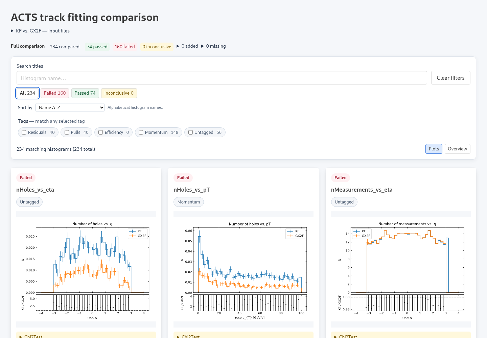
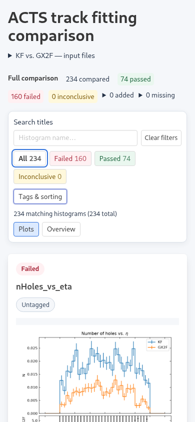
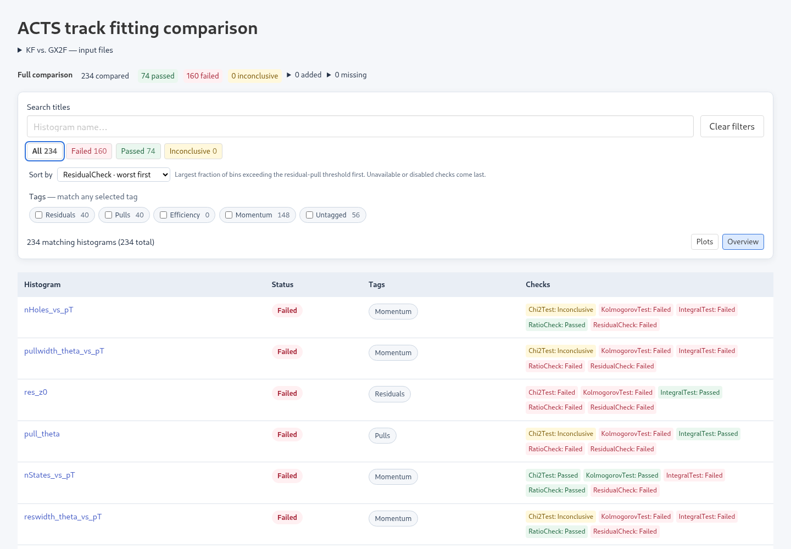
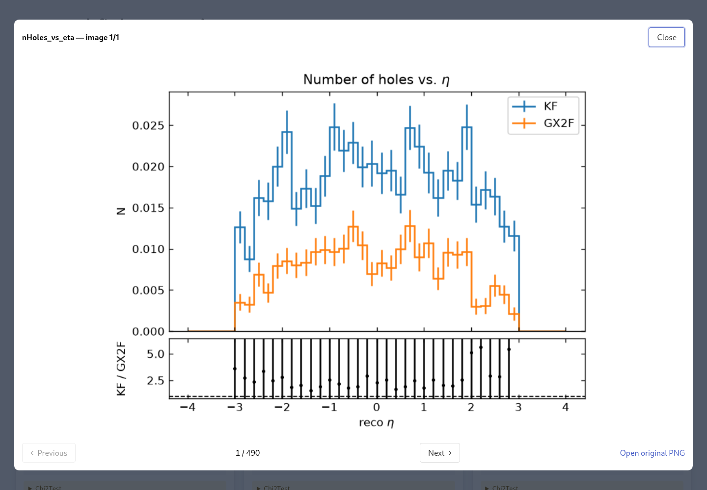

# Browsing reports

Open the generated HTML directly in a browser, or serve it with the SVG directory.

Plots are external SVG files. Text, axes and 1D curves remain vectors; 2D
heatmaps and 3D scatter/voxel data are embedded raster layers at 120 dpi.
This keeps labels sharp when zooming while limiting the size of dense plots.
Publish the HTML and its sibling `<report-stem>_plots/` directory together.
All report scripts, styles, and search data are embedded; no server, CDN, or network
request is needed for the controls. Keep the relative paths to the images intact
when copying a report.

Search titles performs a case-insensitive substring search on histogram names
(the full ROOT keys). Tag and status filters combine with the search.
Clear filters restores all results. Results form one continuous scrolling grid
that adapts from three columns on a
wide display to one on a phone. All, Failed, Passed, and Inconclusive are visible
status buttons with compact padding. Filters scroll with the page; on
phones, Tags & sorting expands the secondary controls.

Only cards near the viewport are mounted; lightweight placeholders preserve the
scrolling space for the rest. Images are requested as they approach the
viewport; browsers without `IntersectionObserver` use native lazy loading.
Click an image for a larger in-page viewer. Left/right arrow keys move through
images in the current filtered order; Escape closes it and returns focus.
“Open original SVG” opens the image separately. Expand a check to read its
details, or copy a histogram heading's link to share its position.

Search text, selected tags, Untagged, status, sorting, and view are stored in the URL. Reloading
or opening a shared URL restores those filters, including with `file://` reports.
Plot heading links keep the filters and add a fragment identifying the plot.
Clear filters removes the filter parameters but keeps the chosen sorting and view.

## Experimental JavaScript plots

SVG remains the default. Add `--js-plots` to try a self-contained HTML report:

```sh
histcmp monitored.root reference.root -o report.html --js-plots --jobs 4
```

The equivalent configuration is `plots.js_plots: true` in YAML or
`js_plots = true` under `[plots]` in TOML. No external plot files are needed in
this mode; the plot directory may be created but remains empty.

Python and Matplotlib still compute comparisons, uncertainties, layout, ticks,
color scales, text outlines, and 3D projections. A bundled JavaScript canvas
renderer replays gzip-compressed drawing commands as cards enter the viewport.
This supports 1D histograms, efficiencies, 2D maps, and 3D scatter/voxel plots.
The 3D view is fixed, just like the SVG output; there is no interactive rotation.
Canvas plots redraw at the display resolution when resized or opened in the
viewer. The viewer's external SVG link is omitted in this mode.

Opening the report directly with `file://` works without a server or CDN. A
browser supporting `DecompressionStream`, `Path2D`, and `DOMMatrix` is required.
If decompression is unavailable, the report displays an error with instructions
to use the default SVG output. Dense 3D drawings can take longer to generate and
render, and data size depends on the plot; this mode is experimental rather than
a guaranteed size reduction. Python calculations retain their full precision.

## Summary, sorting, and overview

The full comparison summary always shows totals before report filters. Expand
Added or Missing to see objects present only in the monitored or reference file.
Status counts respect title search and selected tags; tag counts respect search
and status. Each count describes that individual choice, so overlapping tags do
not add up to the total.

Sort alphabetically, put failures first, or rank by an individual check. P-value
checks put the lowest values first, integral checks use the largest absolute
pull, and ratio/residual checks use the fraction of bins exceeding their configured
threshold. Unavailable and disabled scores come last; names break ties. Scores
from different checks are never combined.

Switch to Overview for compact rows of names, status, tags, and check results,
without loading plot images. Hover a check badge for its numerical details.
Click a histogram name to return to its plot. Both views keep continuous
scrolling and only mount nearby entries; neither uses pagination.

## Tags

Use `--config settings.toml` for TOML or `--config settings.yaml` for YAML.
Files ending in `.toml` (case-insensitive) use TOML; other extensions retain
YAML parsing. Both formats use the same configuration model and CLI overrides.

Add `report.tags` to your configuration. For YAML:

```yaml
checks: {} # Keep your existing check configuration here.
report:
  tags:
    Tracking:
      - "*track*"
      - "*ckf*"
    Efficiency:
      - "eff*"
      - "*/eff*"
    Residuals:
      - "res_*"
```

The equivalent TOML is:

```toml
[checks] # Keep your existing check configuration here.

[report.tags]
Tracking = ["*track*", "*ckf*"]
Efficiency = ["eff*", "*/eff*"]
Residuals = ["res_*"]
```

Check parameters use nested tables, for example
`[checks."*".Chi2Test]` followed by `threshold = 0.01`.
Plot options go under `[plots]`, such as `renderer_3d = "scatter"`.
TOML has no `null` value: omit optional settings to use their defaults.
To disable a check, set `disabled = true` in its table. To reproduce
`comparison_2d3d: null`, explicitly set `comparison_2d3d` to the desired
comparison metric instead of omitting it (its default is `"pull"`).

Patterns are case-sensitive shell globs against the entire histogram key,
including directory prefixes: `*` matches any sequence, `?` one character,
and `[abc]` one listed character. These are not regular expressions.
Any pattern in a tag can match. Tags may overlap; a histogram appears
once in results and lists all matching tags. Unmatched names appear under
Untagged. Existing configurations without `report` continue to work.
Select several tags to match **any** of them, combined with the title search and
status filter. With no tags selected, all plots are included. Clicking a tag chip
on a plot toggles that tag's filter. Untagged can be selected alongside other tags.
The previous `report.categories` spelling is accepted as a compatibility alias;
use `report.tags` for new configurations.

## Browser checks

With Playwright and its Chromium browser installed in a Python environment, run
`python tests/report_browser.py report/index.html`. Use a report with more than
24 histogram cards, or an empty report. This checks `file://` loading, filtering,
continuous scrolling, filter counts, sorting, overview, image viewer, URL restoration,
mobile layout, and the lazy-loading fallback, and writes
desktop, mobile, overview, and viewer screenshots beside nonempty reports.
For a nonempty `--js-plots` report, use
`python tests/jsplot_browser.py report.html` to check canvas rendering, the
viewer, offline loading, and browser capability fallbacks.

## Preview

The ACTS track-fitting comparison on desktop and mobile:





Compact overview and in-page viewer:




